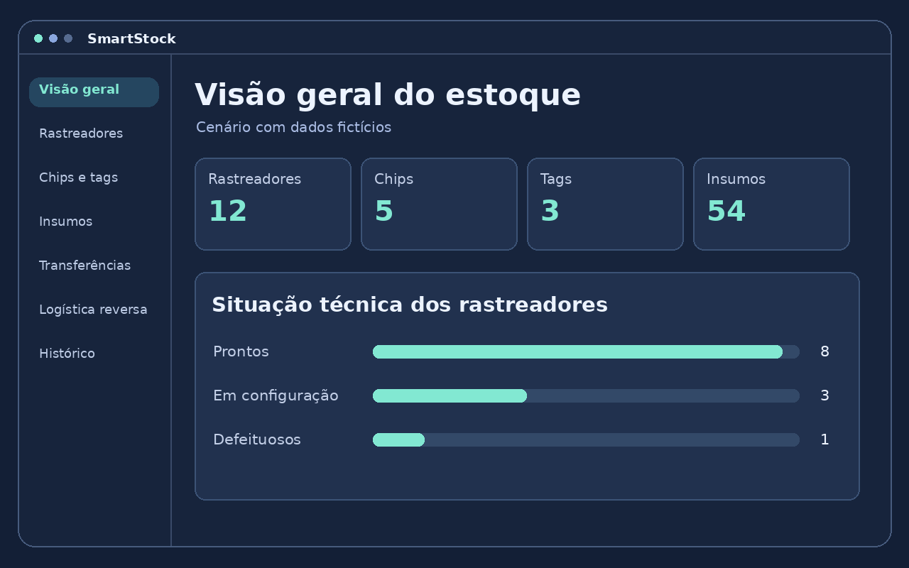

# SmartStock

**Estoque por produto e local, movimentações e custódia de ativos**
Projeto de portfólio de Pedro Henrique Gonçalves.

[Conhecer o projeto](https://pedropr2906.github.io/smartstock-portfolio/) · [Estoque geral](https://pedropr2906.github.io/smartstock-portfolio/estoque.html) · [Ativos serializados](https://pedropr2906.github.io/smartstock-portfolio/demo.html)

## Estoque geral

Cadastre um SKU, informe categoria, unidade de medida e mínimo por local. Registre uma entrada e transfira parte do saldo para um segundo depósito. Confira o saldo, o alerta de reposição e o histórico. A simulação geral é reiniciada ao recarregar a página.

## Módulo de ativos serializados

1. Abra a demonstração e carregue o cenário fictício no painel.
2. Consulte rastreadores, chips e tags, ou cadastre uma entrada em **Lotes e transferências**.
3. Envie um rastreador entre unidades e confirme ou recuse o recebimento. Confira o local e o histórico após a conferência.
4. Explore os indicadores, os protocolos, os saldos de insumos e a logística reversa.

## Ambiente de demonstração

Aplicação estática em HTML, CSS e JavaScript. O cenário fictício é gerado no navegador. O módulo de ativos serializados mantém as alterações no navegador usado no teste. Os perfis representam a interface de acesso. Autenticação, sincronização entre dispositivos e controle de permissões no servidor exigem infraestrutura própria.

Para executar localmente, sirva a raiz do repositório com `python3 -m http.server 8000` e abra `http://localhost:8000`.
